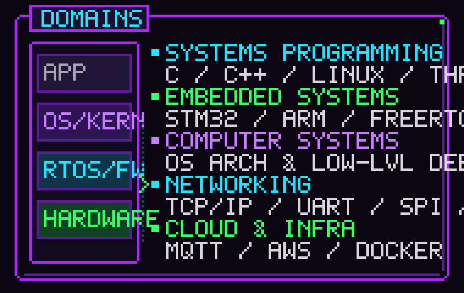
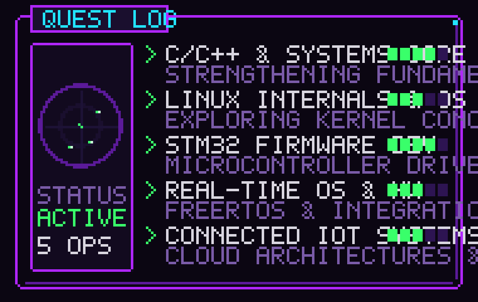
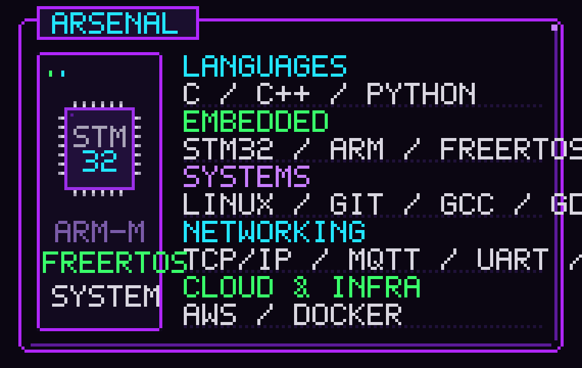
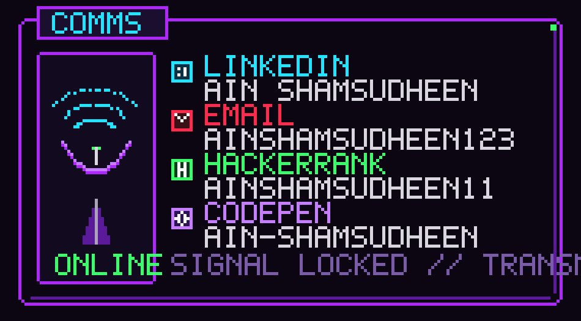

<picture>
  <source media="(prefers-reduced-motion: reduce)" srcset="assets/title-static.svg">
  
</picture>

<picture>
  <source media="(prefers-reduced-motion: reduce)" srcset="assets/card-static.svg">
  
</picture>

I'm a Computer Science and Engineering student interested in building software that interacts with hardware and operates close to the system level.

My interests revolve around **systems programming, embedded firmware, operating systems, computer architecture and connected systems**.

I enjoy understanding how things work beneath the application layer, from microcontroller firmware and memory management to Linux-based systems and network communication.

<picture>
  <source media="(prefers-reduced-motion: reduce)" srcset="assets/interests-static.svg">
  
</picture>

### Technical Interests

- **Systems Programming:** C, C++, Linux, memory management and multithreading.
- **Embedded Systems:** STM32, ARM Cortex-M, firmware development and FreeRTOS.
- **Computer Systems:** Operating systems, computer architecture and low-level debugging.
- **Networking:** TCP/IP, socket programming, UART, SPI and I2C.
- **Cloud & Infrastructure:** MQTT, AWS, Docker and connected-device systems.

<picture>
  <source media="(prefers-reduced-motion: reduce)" srcset="assets/quests-static.svg">
  
</picture>

### Currently Working On

- Strengthening my C/C++ and systems programming fundamentals.
- Exploring Linux internals and operating system concepts.
- Developing embedded firmware using STM32 microcontrollers.
- Learning real-time operating systems and hardware-software integration.
- Exploring cloud-connected embedded systems and IoT architectures.

<picture>
  <source media="(prefers-reduced-motion: reduce)" srcset="assets/tech-static.svg">
  
</picture>

### Technologies & Tools

**Languages:** C, C++, Python

**Embedded:** STM32, ARM, FreeRTOS

**Systems:** Linux, Git, GCC, GDB

**Networking:** TCP/IP, MQTT, UART, SPI, I2C

**Cloud & Infrastructure:** AWS, Docker

<picture>
  <source media="(prefers-reduced-motion: reduce)" srcset="assets/comms-static.svg">
  
</picture>

### Connect With Me

  
  
  
  

- **LinkedIn:** [Ain Shamsudheen](https://www.linkedin.com/in/ain-shamsudheen-8148551b4)
- **Email:** [ainshamsudheen123@gmail.com](mailto:ainshamsudheen123@gmail.com)
- **HackerRank:** [ainshamsudheen11](https://www.hackerrank.com/ainshamsudheen11)
- **CodePen:** [ain-shamsudheen](https://codepen.io/ain-shamsudheen)

---

*Interested in systems engineering, embedded development and building technology that connects software with the real world.*
